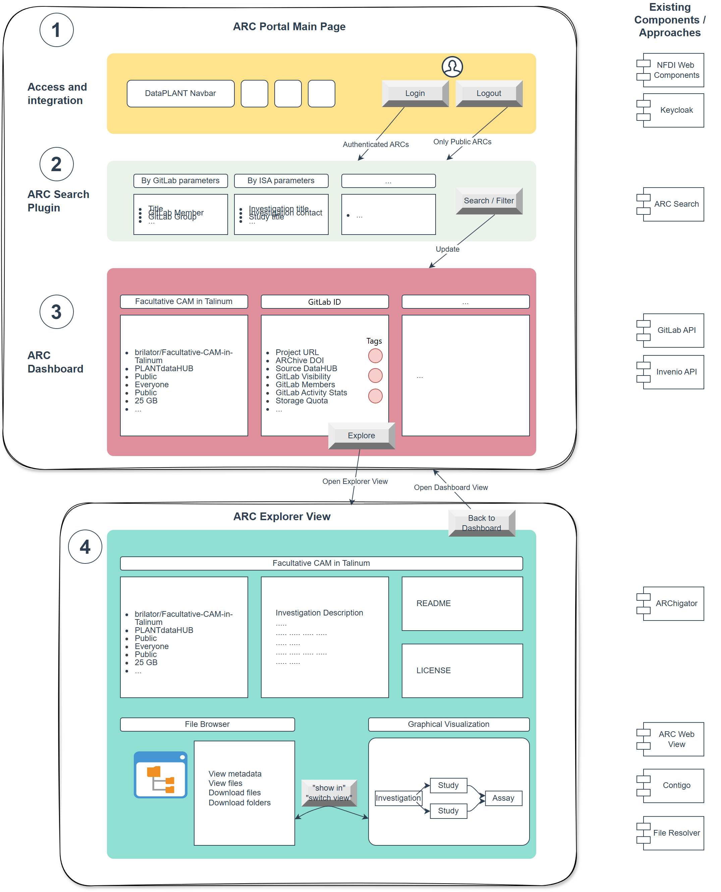
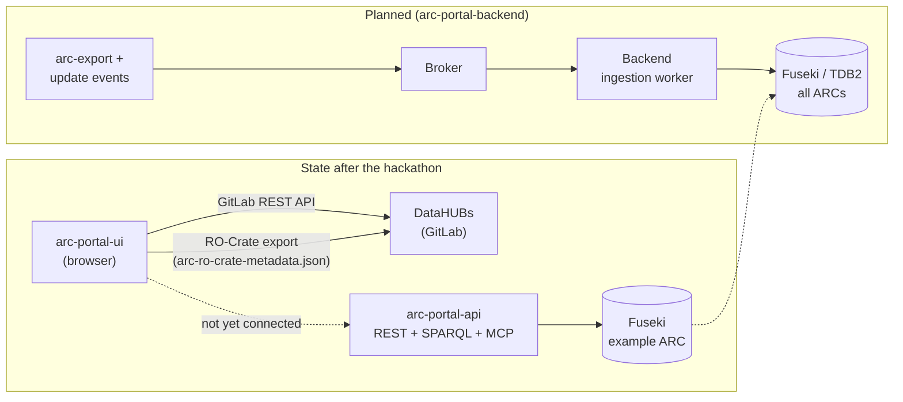
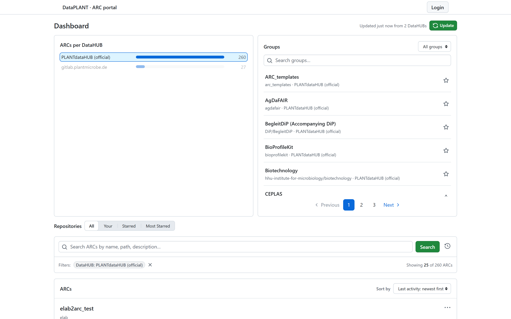
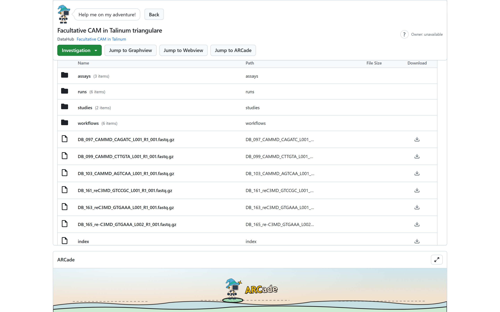
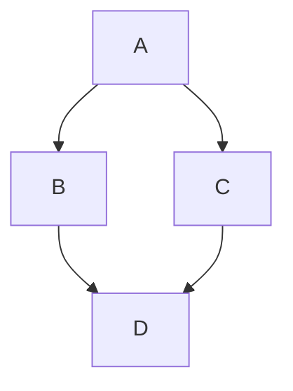

# Introduction

## 1.1 Background
Annotated Research Contexts (ARCs) are currently distributed across a central DataHUB (PLANTdataHUB, Freiburg) and several on-premise instances (HHU, UoC, RPTU, IPK and others). The existing access layer is a customised GitLab interface. For non-technical users such as PIs, journal reviewers or external collaborators, it is complex and confusing: finding ARCs requires GitLab knowledge, there is no search across instances, and the scientific metadata inside an ARC (samples, processes, protocols, ontology terms) cannot be searched at all.

## 1.2 Goals
The hackathon brought together developers, data stewards and infrastructure providers to design and prototype a unified, intuitive ARC Portal. Existing tools (ARCWebView, ARChigator, ARC Metadata Registry) should be integrated into one coherent access layer offering:

* federated search across all DataHUBs,
* single sign-on via Keycloak,
* user-friendly visualisation of ARC content,
* no prior knowledge of ARCs or GitLab required.

Expected outcomes defined in the application:

a working prototype of the ARC Portal aggregating ARCs from all DataHUBs,
a prioritised feature roadmap,
documentation (user, admin and developer) including a sustainability and open-source maintenance concept,
this hackathon report.

### 1.3 Preparation and format

Before the event, a schematic concept sketch illustrated the envisioned portal (Figure \ref{fig:concept}), and
the concept was split into five sub-projects (milestones in the `ARC-Portal` repository):




1. ARC Portal main page
2. ARC search plugin
3. ARC dashboard
4. ARC explorer view
5. Docs and roadmap

The event consisted of an introduction and group formation on day 1, five code sessions over the
three days, a documentation session per project and a final wrap-up and roadmap session.

During the project discussion on day 1, the participants consolidated the five planned
sub-projects into **three working groups**, based on the number of participants and their
expertise:

| Working group | Planned sub-projects covered | Results |
|---|---|---|
| **1. User stories** | requirements for all sub-projects; input for 5 (Docs and roadmap) | Section 2.1 |
| **2. Backend and API** | 2 (ARC search plugin), metadata search backend | Section 2.2 |
| **3. Portal UI** | 1 (Main page), 3 (ARC dashboard), 4 (ARC explorer view) | Section 2.3 |

Documentation and roadmap (sub-project 5) were not handled by a separate group but by each group
in the documentation session on day 3 and in the joint wrap-up.

The scope was also narrowed deliberately for the time available: the prototype targets the
official PLANTdataHUB plus one additional DataHUB instead of all DataHUBs, and single sign-on via
Keycloak was postponed (see Section 3).

# Results

The user stories group documented its results in the existing `ARC-Portal` repository. The
backend/API group and the UI group created three new repositories:

| Repository | Focus | Technology | State after the hackathon |
|---|---|---|---|
| `arc-portal-ui` | Portal frontend: DataHUB dashboard, ARC dashboard, provenance explorer | React 19, TypeScript, Vite, Primer React, `@nfdi4plants/arctrl`, `@nfdi4plants/arc-web-view`, ELK | Working prototype, deployed via GitHub Pages; ~250 commits, ~40 PRs (12 to 16 Oct) |
| `arc-portal-api` | Read-only REST API over ARC RO-Crate metadata in a triple store | Python 3.12, Litestar, Apache Jena Fuseki, MCP | Implemented and tested against an example ARC |
| `arc-portal-backend` | Architecture of the metadata ingestion and query backend | Documentation (architecture, roadmap) | Architecture and roadmap only; no code yet (intentionally) |




### 2.1 User stories

User stories were collected at the beginning of the event and recorded in
`ARC-Portal/User_Stories/user_stories.md`. They cover four personas: PIs and consortium speakers
(little or no ARC knowledge, little time, no tool installation), journal reviewers (one ARC link
from a manuscript), ARC users (create ARCs themselves) and data stewards.

| # | User story | Coverage after the hackathon |
|---|---|---|
| US1 | As a PI I want to find all ARCs of my group (all visibilities, all DataHUB instances, by group membership). | **Partial (UI):** organisation browser with "Your organisations", "Your repos" filter after login; two DataHUBs supported. |
| US2 | As a journal reviewer I want to see one ARC in a nice visualisation (README with clickable links, process graphs, easy file browsing/download). | **Prototype (UI):** ARC dashboard with investigation dashlets, embedded ARC Web View and provenance explorer. Note from the discussion: most of US2 belongs into the ARCWebView itself, so it can be reused e.g. in Invenio/ARChive. |
| US3 | As a user I want to see all ARCs related to my research project (search by metadata such as organism or method, and see *where* in the ARC the match was found). | **Partial:** API offers full-text search, facets and ISA-aware filters (organism, measurement technique, factor, characteristic, parameter). UI search is still limited to GitLab project name, path and description. |
| US4 | As the speaker of a consortium (CEPLAS, MibiNet, ...) I want to see who in the consortium created ARCs for their project. | **Not covered.** API has `persons`/`organizations` endpoints that could support it. Discussion: possibly a plugin for supervisors; search by user name vs. creator still open. |
| US5 | As a user I want to host ARCs on different DataHUB instances and overlook all of them in one place (one login, all instances). | **Partial (UI):** multi-DataHUB, multi-account support; one login per DataHUB (token), not yet SSO. |
| US6 | Show all ARCs that person XY contributed to (by DataHUB member name or ISA contact). | **Partial (API):** `GET /arcs?person=<name or ORCID>` filters by ISA contacts. Not in the UI yet. |
| US7 | Show all ARCs that are published with a DOI. | **Not covered.** API exposes `publications`; a DOI filter and ARChive link are missing. |
| US8 | Get a graphical (clickable) overview of how items in the ARC are connected. | **Prototype (UI):** provenance explorer (ELK graph, breadcrumbs, expandable nodes, zoom). |
| US9 | Click-download all dataset, protocol files and metadata related to a selected set of samples. | **Not covered.** API `files` and lineage-aware sample queries are a possible basis. |
| US10 | Trace back the origin of selected datasets. | **Partial:** provenance explorer (UI); lineage-aware filters (API); "paths from input samples to results" is a core use case of the backend design. |
| US11 | Visually follow the development of my ARC over commits (growing tables, process graph, validation results). | **Not covered.** Historical graph browsing is explicitly deferred in the backend design. |
| US12 | See what changed between one commit and another. | **Not covered** (see US11). |


### 2.2 Backend, database and API

#### 2.2.1 `arc-portal-backend`: architecture
https://github.com/nfdi4plants/arc-portal-backend 

The backend group produced an architecture and roadmap for a **metadata-centric** portal backend
that searches the scientific metadata *inside* ARCs (going beyond repository metadata in the
DataHUB). By design decision, no code was written yet; the documentation explicitly states that
it does not authorise implementation.

**Product focus:** scientific metadata search and ARC exploration, for example:

| Capability | Example question |
|---|---|
| Search scientific metadata | Which samples have a watering-exposure value of "12 days drought"? |
| Combine conditions | Which metabolite extraction processes use ribitol as the internal standard? |
| Explore provenance | Which sample went through which process and protocol, and what did it produce? |
| Compare ARCs | Which ARCs use the same annotated protocol or ontology term? |
| Show statistics | How many samples are recorded for each treatment? |
| Inspect metadata coverage | Which processes have no recorded protocol? |

Users work with filters, tables and relationship views; the backend translates them into SPARQL.
Embeddings, historical graph browsing and a separate analytics service are deferred until a
concrete need is demonstrated.

**Initial architecture (deliberately small):**

- Existing `arc-export` produces RO-Crate snapshots per ARC commit and announces *metadata update
  events*.
- Snapshots are retained in existing durable storage (for replay and recovery).
- One durable broker buffers update events (reuse an existing broker; otherwise NATS JetStream as
  provisional candidate, Kafka as alternative).
- **One backend application** with one sequential ingestion worker plus the query API.
- **Apache Jena Fuseki / TDB2** stores the current RDF, revisions and receipts.
- Everything is delivered via **Docker Compose** (local and cloud), with structured logs, basic
  metrics and database inspection from the start.

**Correctness principles:** stable ARC identity independent of repository URL, assertion
ownership per ARC, atomic commit of graph changes + source revision + receipt, safe handling of
duplicates, delayed events and crashes, authorisation for private sources. Atomic replacement of
an ARC's graphs is the baseline; source-local RDF diffs are a candidate if measurements justify
them. A shared terminology was defined (RO-Crate snapshot, metadata update event / ID, metadata
ingestion, ingestion lag; "publication" reserved for ARChive).

**Implementation roadmap** (discussion summary of 13 October 2026, `plans/implementation-roadmap.md`;
proposal, implementation not yet started). First useful milestone: *start Fuseki with Docker
Compose, import two real ARC RO-Crate ZIPs and run metadata queries against them.* The roadmap
defines five work packages, each with a smallest useful scope and completion evidence:

| Work package | Smallest useful scope | Completion evidence |
|---|---|---|
| **WP1 Fuseki Compose foundation** | Pinned Fuseki version, persistent TDB2 storage, health checks, query/update endpoints, browser inspection; local and cloud configuration documented. | Insert/query a small graph, restart, verify persistence; inspect graph and logs. |
| **WP2 Reusable RO-Crate ZIP importer** | Containerised CLI around a reusable ingestion function: exporter ZIP plus explicit ARC identity/revision in, atomic whole-ARC replacement of that ARC's metadata. | Import two ARCs; update A without changing B; repeated update is harmless; malformed input is rejected without damage; relative identifiers resolve correctly. |
| **WP3 DataHUB package notification** | After a successful export-package upload, send a small package-reference notification; develop against a mock receiver first. | Reference resolves to the expected ZIP; download with backend-owned credentials; retries reuse the update ID; failures visible and retryable. |
| **WP4 Query prototypes and fixtures** | Two pinned real ARC snapshots, explicit seed command (using WP2), small set of SPARQL queries with expected results. | Treatment filtering, sample/process/protocol traversal, shared ontology annotations across ARCs, a count or coverage query. |
| **WP5 Durable ingestion** | One persistent queue and one sequential worker calling the same importer; retries, duplicate handling, revision eligibility, inspectable failures. | Duplicate delivery, crash/restart, lost commit response, unavailable package or Fuseki, malformed input and delayed older updates are handled; old notifications never replace newer metadata. |

Key clarifications from the roadmap discussion:

- **Package references instead of re-uploading ZIPs:** each ARC's export ZIP is already stored in
  its GitLab package registry, with the Git commit hash as package version. The export job only
  notifies the backend *after* a successful upload (DataHUB instance, project, ref, commit,
  package coordinates, checksum, metadata update ID); the backend downloads the ZIP with its own
  read credentials. Retention, cleanup and duplicate-upload behaviour of the registry still need
  to be verified, since a commit-hash version does not guarantee identical bytes.
- **Named graphs and IRIs:** one named graph per ARC allows querying, replacing or removing one
  ARC independently. Relative RO-Crate identifiers (e.g. `#Sample1`) must be resolved against a
  stable, source-specific base IRI (proposed basis: DataHUB instance plus immutable project ID),
  not against a versioned package URL or a temporary directory. Shared absolute IRIs (ontology
  terms, ORCIDs) are kept, which enables cross-ARC comparisons.
- **Parallel work:** WP1 to WP5 can start in parallel using fixtures, mock receivers and stub
  importers, once a small shared contract is agreed (two pinned fixtures, one example
  notification, identity/base rules, importer inputs/outputs).
- **Recovery terminology:** retry, event replay, snapshot re-import and database rebuild are
  distinguished explicitly; none of them means re-running an experiment or creating a new export.
- **Deferred optimisations:** source-local RDF diffing, batching, skipping superseded snapshots
  and parallel workers are only added when measurements justify them.

#### 2.2.2 `arc-portal-api`: REST API on the triple store

https://github.com/nfdi4plants/arc-portal-api

The API group implemented a working **read-only REST API** (Python, Litestar) on top of a Fuseki
triple store containing ARC RO-Crate metadata.

- **ISA-aware endpoints** for ARCs, studies, assays, workflows, runs, samples, processes,
  protocols, files, persons, organisations and publications, per ARC and globally, with filters
  and pagination.
- **Lineage-aware filters:** a sample matches a factor/characteristic filter if it *or any
  ancestor* in the process chain carries the value (e.g. extracts inherit the organism of their
  source).
- **Discovery:** full-text search across entity types and filter facets for UIs.
- **Guarded SPARQL proxy:** only `SELECT`/`ASK`/`CONSTRUCT`/`DESCRIBE`, no updates or `SERVICE`,
  enforced limits, common prefixes predeclared, several result formats.
- **Agent / chatbot support:** an LLM-oriented SPARQL guide rendered for the current store, live
  vocabulary, tested natural-language-to-SPARQL examples and an **MCP server** (`/mcp`), so that
  e.g. Claude Code can query ARC metadata directly.
- OpenAPI 3.1 with interactive docs, Docker image, central `config.yaml`, pytest suite that runs
  offline against an in-memory rdflib snapshot in three graph layouts (default, named, two ARCs
  mixed), plus optional live tests.

**Current data basis:** one example ARC (`Facultative-CAM-in-Talinum`, from QuARC) loaded into the
default graph of a Fuseki test instance, with IRIs resolved against a local file path. The
recommended target layout is one named graph per ARC with a stable base IRI (e.g. the repository
URL).


### 2.3 Portal UI (`arc-portal-ui`)

https://github.com/nfdi4plants/arc-portal-ui

The UI group built a working frontend prototype that talks **directly to the GitLab API of the
DataHUBs from the browser** (no portal backend required) and loads each ARC's generated
RO-Crate export for the detail views.

**DataHUB dashboard (entry page)** (Figure \ref{fig:datahub})

- Most-starred public ARCs, server-side search (project name, path, description) and an
  organisation (GitLab group) browser incl. subgroups, with paging, loading, empty, error and
  retry states.
- **Multi-DataHUB, multi-account:** PLANTdataHUB (official) and `gitlab.plantmicrobe.de` are
  configured; further instances can be added in configuration. (RPTU was removed due to CORS
  restrictions.)
- **Optional login** with a GitLab personal access token per DataHUB: shows private and internal
  ARCs, "Your organisations", filter presets ("your repos", "most starred"), star/unstar and a
  "Starred" filter. Tokens are sent only as `Authorization: Bearer` headers.
- Responsive ARC list, favourite groups, repository counts per DataHUB and group.



**ARC dashboard (one ARC)** (Figures \ref{fig:graphview} and \ref{fig:webview})

- ARC data store on top of `@nfdi4plants/arctrl`: fetches
  `isa_arc_json/0.0.1/arc-ro-crate-metadata.json` from the DataHUB, parses it and exposes plain
  data to React components via selectors and hooks (investigation, studies/assays, people,
  annotations, provenance).
- Investigation header and dashlets (counts of studies, assays, runs, workflows, publications,
  people; pop-up dashlets), investigation context menu.
- Embedded **ARC Web View** (`@nfdi4plants/arc-web-view`); selecting an assay, study, run or
  workflow opens its folder in the Web View.
- **Provenance explorer:** provenance index built from the parsed ARC, ELK-based graph canvas
  with breadcrumbs, expandable nodes, zoom and accessibility support (addresses US8/US10).
- Several dashboard layouts (classic, scrolling, split, tabbed, stacked, circular, combined)
  explored in **Storybook** with the bundled Talinum ARC; the scrolling dashboard was chosen for
  the application.
- Loading screen ("ARC-Wizard").
- Tests with Vitest and React Testing Library (no live GitLab needed), lint, build, GitHub Pages
  deployment.




**Side project "ARCade":** a browser game in the ARC world (ARCitect, ARC Commander, Git LFS,
ontology fragments, the "FAIR trader", ...) was developed as dashlets during the event and has
since been moved into its own package/repository (`arc-rdg/ARCade`). TODO: decide how to present
this (community/outreach, onboarding element).


# Discussion

The original plan of five sub-projects, integration of all DataHUBs and single sign-on via
Keycloak proved too ambitious for a three-day event. Consolidating the work into three groups
allowed each group to reach a working result instead of five partial ones. Integrating all
DataHUBs would have required coordination with every infrastructure provider on CORS, access and
accounts, which was not possible during the event, and SSO depends on authorisation decisions
that are still open. Both remain goals of the project and are part of the plan in Section 4.

The three groups worked in parallel on different layers of the portal, and their results
complement each other but are not yet connected. The UI uses only the GitLab API and the RO-Crate
export of each ARC. It can therefore browse ARCs across DataHUBs and visualise a single ARC, but
it cannot search the scientific metadata across ARCs. The API can answer exactly these questions,
for example which samples carry a certain factor or which ARCs a person contributed to (US3, US6,
US10), but so far only for one example ARC. The backend architecture finally describes how all
ARCs would get into the triple store. The hackathon thereby made an important distinction
explicit: discovery at repository level (names, groups, stars, visibility) can be done directly
against GitLab, while metadata-centric search over samples, factors, protocols, ontology terms
and provenance requires an ingestion pipeline and a graph database. Both serve different user
stories, and the portal needs both. Connecting the three pieces is therefore the central next
step.

The missing link between them is ingestion. Today, data is loaded into Fuseki manually and with
machine-dependent IRIs. A reliable path from an ARC commit via `arc-export` into named graphs
with stable IRIs, which also handles deletions, force pushes and private ARCs, is the main
technical risk of the project and is addressed by work packages WP2 to WP5 of the backend
roadmap. A helpful finding of the discussion is that the export ZIPs already exist in the package
registry of each ARC, versioned by commit hash, so that the backend can fetch them by reference
instead of requiring a second upload. Whether ordinary Fuseki handles snapshot replacement, blank
nodes and the targeted scale of more than 100 million triples acceptably has not been tested yet.

Closely related are the questions of access. As an interim solution for the postponed SSO, the
prototype uses one GitLab personal access token per DataHUB. This works for developers but not
for the target personas such as PIs and reviewers. Once private ARCs are included in the metadata
search, the backend must also ensure that users only see metadata they are allowed to see; this
cannot be derived from the uploaded metadata alone and needs to be decided early. Federation
raises a similar issue: direct browser access requires each GitLab instance to allow the portal
via CORS, which is why the RPTU instance had to be removed from the prototype. Connecting all
on-premise DataHUBs therefore requires either coordinated CORS configuration with the
infrastructure providers or a server-side component.

The goal of integrating existing tools into one access layer was only partly reached. The UI
builds on arctrl and the ARC Web View, and the backend design reuses `arc-export`, whereas
ARChigator, the ARC Metadata Registry and other DataPLANT components such as ARCSearch,
DataHubClient and Keycloak are not used yet. The discussion of the reviewer
story (US2) also showed that most visualisation features belong in the ARC Web View itself, so
that they become available in other places such as Invenio and the ARChive, while the portal
embeds the Web View. A smaller point concerns result quality: the UI currently treats every
repository as an ARC, so a simple check, for example for the presence of an RO-Crate export,
would keep non-ARC repositories out of the results.

Beyond the original goals, the API group added an MCP server and an LLM-oriented SPARQL guide,
which make the ARC metadata directly usable by chatbots and agents. This could open metadata
search to users who cannot or do not want to work with filters or SPARQL. To become a community
project, however, the code itself needs to be open: apart from `arc-portal-ui`, the repositories
are currently private, and making them public and adding licences is a prerequisite for shared
maintenance. Several user stories are not covered yet, namely consortium and person views in the
UI (US4, US6), a DOI or publication filter (US7), the download of files for selected samples
(US9) and the history and comparison of commits (US11, US12). User and admin documentation and the
hand-over of responsibilities are also still open; these points are taken up in the plan.


# Plan 

## Meeting information 

If you want to submit a preprint to BioHackrXiv, first check if your meeting is registered. You can find a list
of meetings [here](https://index.biohackrxiv.org/meetings). If your meeting is missing, please contact your meeting
organizers. The above list also provides information on the YAML fields with information about the meeting.

The following fields need to be given:

```YAML
biohackathon_name: "BioHackathon Europe 2023"
biohackathon_url:   "https://biohackathon-europe.org/"
biohackathon_location: "Barcelona, Spain, 2023"
group: Project 26
git_url: https://github.com/yourOrganization/your_report_repo
```

The [BioHackrXiv meeting pages](https://index.biohackrxiv.org/meetings) provide content to use for the first
three fields. The `git_url:` field must have the link to the GitHub repository with your preprint (draft).

## Author information

Information about the authors is given in the [YAML](https://en.wikipedia.org/wiki/YAML) format at the top of this template.
For authors you provide their names, their affiliations. That is the minimum, but as BioHackrXiv is moving to a situation
where more metadata is shared, and used by, for example, EuropePMC, adding additional information ie encouraged.

BioHackathons is about hacking together, and the minimal number of authors for reports is two. This makes a minimal example
look like this:

```yaml
authors:
  - name: First Author
    affiliation: 1
  - name: Last Author
    affiliation: 2
affiliations:
  - name: First Affiliation
    index: 1
  - name: ELIXIR Europe
    index: 2
```

### Author identifiers

Ideally, authors provide their [ORCID](https://orcid.org/) identifier. For affiliations, It is added with the `orcid:` field.
So, and author record would look like this:

```yaml
authors:
  - name: First Author
    affiliation: 1
    orcid: 0000-0000-0000-0000
```

### Research Organization Registry identifiers

Matching the author identifier, the affiliations can be further specified with the
[Research Organization Registry](https://ror.org/) (ROR) identifier.
For example, this is the affiliation identifier can be added with the `ror:` field:

```yaml
affiliations:
  - name: ELIXIR Europe
    ror: 044rwnt51
    index: 2
```

### Contributor Role Taxonomy

A last feature since is minimal support for the Contributor Role Taxonomy (CRediT). You
can specify the role of authors in writing the report with the `role:` field. However,
the authors are responsible for selection the right terms from [CRediT](https://credit.niso.org/).
An example looks like this:

```yaml
authors:
  - name: First Author
    affiliation: 1
    orcid: 0000-0000-0000-0000
    role: Conceptualization, Writing – review & editing
```

### A full examples

A full example then has this structure:

```yaml
authors:
  - name: First Author
    affiliation: 1
    role: Writing – original draft
  - name: Last Author
    orcid: 0000-0000-0000-0000
    affiliation: 2
    role: Conceptualization, Writing – review & editing
affiliations:
  - name: First Affiliation
    index: 1
  - name: ELIXIR Europe
    ror: 044rwnt51
    index: 2
```

# Formatting

This document use Markdown and you can look at [this tutorial](https://www.markdowntutorial.com/).

## Subsection level 2

Please keep sections to a maximum of only two levels.

## Tables

Tables can be added in the following way, though alternatives are possible:

```markdown
Table: Note that table caption is automatically numbered and should be
given before the table itself.

| Header 1 | Header 2 |
| -------- | -------- |
| item 1 | item 2 |
| item 3 | item 4 |
```

This gives:

Table: Note that table caption is automatically numbered and should be
given before the table itself.

| Header 1 | Header 2 |
| -------- | -------- |
| item 1 | item 2 |
| item 3 | item 4 |

## Figures

A figure is added with:

```markdown

```

This gives:


Figures can be scaled by adding the width or height to the Markdown like this:

```markdown
{ width=50px }
```

You can add cross references to figures by adding a LaTeX `\label{figureCode}` to
the label of the Markdown figure and then use `\ref{figureCode}` to cite it:

```markdown
{ width=50px }
```

This way, we can cite Figure \ref{figureCode}.

## Mermaid graphs

[Mermaid](https://mermaid.js.org/) provides a solution to put diagrams in Markdown. BioHackrXiv
added support for this in 2026. This is an example of embedding a graph:



# Other main section on your manuscript level 1

Lists can be added with:

1. Item 1
2. Item 2

# Citation Typing Ontology annotation

You can use [CiTO](http://purl.org/spar/cito/2018-02-12) annotations, as explained in [this BioHackathon Europe 2021 write up](https://raw.githubusercontent.com/biohackrxiv/bhxiv-metadata/main/doc/elixir_biohackathon2021/paper.md) and [this CiTO Pilot](https://www.biomedcentral.com/collections/cito).
Using this template, you can cite an article and indicate _why_ you cite that article, for instance DisGeNET-RDF [@citesAsAuthority:Queralt2016].

The syntax in Markdown is as follows: a single intention annotation looks like
`[@usesMethodIn:Krewinkel2017]`; two or more intentions are separated
with colons, like `[@extends:discusses:Nielsen2017Scholia]`. When you cite two
different articles, you use this syntax: `[@citesAsDataSource:Ammar2022ETL; @citesAsDataSource:Arend2022BioHackEU22]`.

Possible CiTO typing annotation include:

* citesAsDataSource: when you point the reader to a source of data which may explain a claim
* usesDataFrom: when you reuse somehow (and elaborate on) the data in the cited entity
* usesMethodIn
* citesAsAuthority
* citesAsEvidence
* citesAsPotentialSolution
* citesAsRecommendedReading
* citesAsRelated
* citesAsSourceDocument
* citesForInformation
* confirms
* documents
* providesDataFor
* obtainsSupportFrom
* discusses
* extends
* agreesWith
* disagreesWith
* updates

There is a general `cites` intention, but this is already implied and should be left out.

# Results


# Discussion

...

## Acknowledgements

...

# References

```{=latex}
\AtEndDocument{%
```

# Appendices

If you want the Appendix (-ces) to show up after the references, wrap them in 
after the header, like done in this Markdown file. Look at the [source](paper.md)
to see the exact structure.

```{=latex}
}
```
